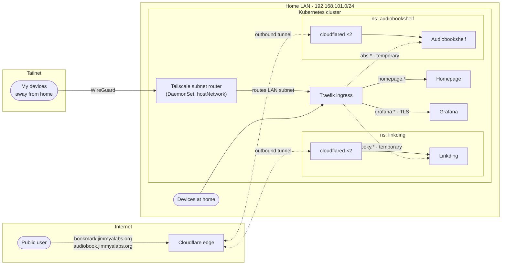
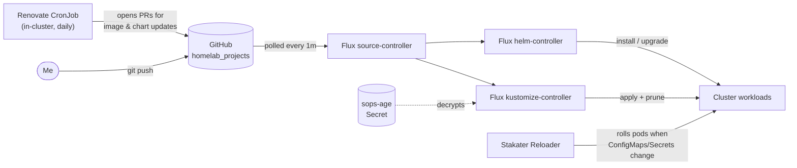

# homelab_projects

GitOps configuration for my home Kubernetes cluster. Everything running on the cluster is declared in this repo and reconciled by [Flux](https://fluxcd.io/): I push to `main`, and the cluster changes to match within a minute. Secrets are encrypted in Git with [SOPS](https://github.com/getsops/sops) + [age](https://github.com/FiloSottile/age), and container images and charts are kept current by a [Renovate](https://docs.renovatebot.com/) bot that runs inside the cluster.

## Architecture

### How traffic reaches the apps



There are three ways in:

| Path | Who uses it | How it works |
| --- | --- | --- |
| **Cloudflare Tunnel** | Anyone on the internet | Each public app runs its own `cloudflared` deployment (2 replicas) that dials *out* to Cloudflare, so no ports are opened on my router. Used for Linkding and Audiobookshelf. |
| **Tailscale** | Me, from anywhere | A Tailscale DaemonSet advertises the home LAN as a subnet route (and acts as an exit node), so my devices reach the cluster's ingress as if they were at home. Each node gets its own Tailscale identity. |
| **Traefik ingress** | LAN and tailnet clients | Private hostnames under `jimmyalabs.org` for admin tools (Homepage, Grafana) that are never exposed publicly. |

Linkding and Audiobookshelf also have temporary private ingresses (`booky.*`, `abs.*`, the dashed lines in the diagram). These will be removed, leaving the Cloudflare tunnel as the only way into those apps.

### How changes get to the cluster



- Flux watches `./clusters/stage`, which defines five Flux `Kustomization`s: `apps`, `infra-controllers`, `infra-configs`, `monitoring-controllers` and `monitoring-configs`. Each one points at a directory in this repo, has `prune: true` (anything deleted from Git is deleted from the cluster), and decrypts SOPS secrets with the `sops-age` key.
- Renovate runs as a daily CronJob in the cluster and opens a PR for each new image digest, chart version or Flux release. Merging the PR is the deploy.
- Reloader restarts deployments annotated with `reloader.stakater.com/auto: "true"` whenever their ConfigMaps or Secrets change, so a config edit in Git rolls the pods automatically.

## What's running

| Component | Layer | Purpose | Installed via |
| --- | --- | --- | --- |
| [Linkding](https://github.com/sissbruecker/linkding) | apps | Self-hosted bookmark manager | Plain manifests |
| [Audiobookshelf](https://www.audiobookshelf.org/) | apps | Audiobook and podcast server | Plain manifests |
| [Homepage](https://gethomepage.dev/) | infra | Dashboard that auto-discovers services from ingress annotations | Plain manifests |
| [Tailscale](https://tailscale.com/) | infra | Subnet router and exit node for remote access | Plain manifests (DaemonSet) |
| [Renovate](https://docs.renovatebot.com/) | infra | Automated dependency update PRs | CronJob |
| [Reloader](https://github.com/stakater/Reloader) | infra | Restarts pods on config/secret changes | Flux `HelmRelease` |
| [kube-prometheus-stack](https://github.com/prometheus-community/helm-charts/tree/main/charts/kube-prometheus-stack) | monitoring | Prometheus, Alertmanager and Grafana | Flux `HelmRelease` (drift detection on) |
| Cloudflare Tunnel (`cloudflared`) | apps | Public access without open ports | Plain manifests, per app |

## Repository layout

The repo uses Flux's recommended **base / overlay** pattern: `base/` holds environment-agnostic manifests, and each environment directory (currently `stage/`) pulls in a base with Kustomize and adds what's specific to that cluster, such as ingresses, tunnels and secrets.

```
.
├── clusters/
│   └── stage/                  # Entry point Flux watches
│       ├── flux-system/        # Flux's own components (generated by `flux bootstrap`)
│       ├── apps.yaml           # Flux Kustomization → ./apps/stage
│       ├── infra.yaml          # Flux Kustomizations → ./infra/{controllers,configs}/stage
│       ├── monitoring.yaml     # Flux Kustomizations → ./monitoring/{controllers,configs}/stage
│       └── .sops.yaml          # Encryption rules: only data/stringData, age recipient
├── apps/
│   ├── base/                   # Deployment, Service, PVC, Namespace per app
│   │   ├── audiobookshelf/
│   │   └── linkding/
│   └── stage/                  # + cloudflared tunnel, encrypted tunnel creds, temporary Ingress
├── infra/
│   ├── controllers/            # Cluster services: homepage, reloader, renovate, tailscale
│   │   ├── base/
│   │   └── stage/
│   └── configs/                # Configuration for those services (homepage config)
│       └── stage/
├── monitoring/
│   ├── controllers/            # kube-prometheus-stack HelmRepository + HelmRelease
│   │   ├── base/
│   │   └── stage/
│   └── configs/                # Grafana TLS certificate (encrypted)
│       └── stage/
└── renovate.json               # Lets Renovate find images in every *.yaml file
```

## Security practices

- **No plaintext secrets in Git.** Every `Secret` is SOPS-encrypted with age before it's committed. Only the `data`/`stringData` values are encrypted, so diffs stay readable. Flux decrypts them in-cluster with a private key that never leaves the cluster.
- **No inbound ports.** Public apps are reached only through outbound Cloudflare tunnels, and admin access goes over Tailscale.
- **Hardened containers.** Workloads run as non-root users with `allowPrivilegeEscalation: false`. Where the app allows it, all Linux capabilities are dropped, a `RuntimeDefault` seccomp profile is applied and the root filesystem is read-only. The Tailscale pod adds back only `NET_ADMIN` and `NET_RAW`.
- **Least-privilege RBAC.** Homepage gets a `get`/`list`-only ClusterRole for the resources it reads. Tailscale's Role is scoped to its own namespace's Secrets.
- **Pinned images.** Most images are pinned by `sha256` digest, and Renovate bumps them through reviewed PRs.

## Bootstrapping a cluster from this repo

Prerequisites: a running Kubernetes cluster with Traefik as the ingress controller, `kubectl`, the [`flux` CLI](https://fluxcd.io/flux/installation/), `sops`, `age`, and a GitHub personal access token.

1. **Install the age key** so Flux can decrypt secrets:

   ```sh
   kubectl create namespace flux-system
   kubectl -n flux-system create secret generic sops-age \
     --from-file=age.agekey=/path/to/age.agekey
   ```

2. **Bootstrap Flux** against this repo:

   ```sh
   flux bootstrap github \
     --owner=jimmyayoade \
     --repository=homelab_projects \
     --branch=main \
     --path=./clusters/stage \
     --personal
   ```

3. **Watch it reconcile:**

   ```sh
   flux get kustomizations --watch
   flux get helmreleases -A
   ```

### Editing secrets

```sh
# Encrypt a new secret in place (the rules come from clusters/stage/.sops.yaml)
sops --encrypt --in-place --config clusters/stage/.sops.yaml apps/stage/<app>/<secret>.yaml

# Edit an existing one
SOPS_AGE_KEY_FILE=/path/to/age.agekey sops --config clusters/stage/.sops.yaml <file>.yaml
```

### Adding an app

1. Create `apps/base/<app>/` with a Namespace, Deployment, Service, any PVCs and a `kustomization.yaml`.
2. Create `apps/stage/<app>/` with a `kustomization.yaml` that references `../../base/<app>/`, plus a `cloudflared` tunnel if the app should be public or an Ingress if it should be private.
3. Commit and push. `apps/stage/` has no top-level `kustomization.yaml`, so Flux generates one and picks up every app directory automatically.

## Roadmap

- [ ] Remove the temporary private ingresses for Linkding and Audiobookshelf (`booky.*`, `abs.*`)
- [ ] Move the Grafana admin password into a SOPS-encrypted Secret
- [ ] CI on pull requests: `kustomize build` + `kubeconform` for every overlay
- [ ] Pin the remaining `:latest` images (`cloudflared`, `renovate`)
- [ ] Resource requests/limits and readiness probes on every workload
- [ ] Switch from Flannel to Cilium as my CNI
- [ ] NetworkPolicies between namespaces
- [ ] Backups for PVCs (e.g. Velero)
- [ ] Add a `prod` overlay alongside `stage`
